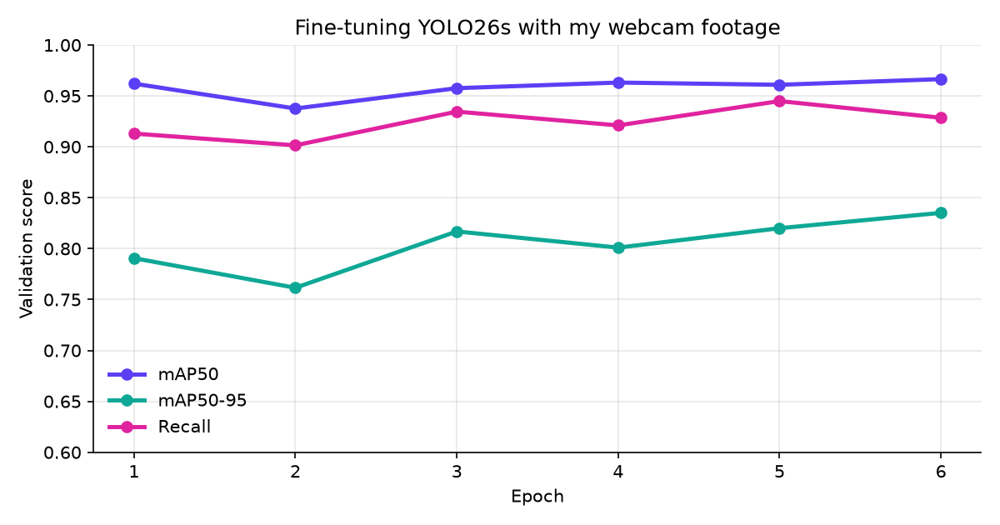
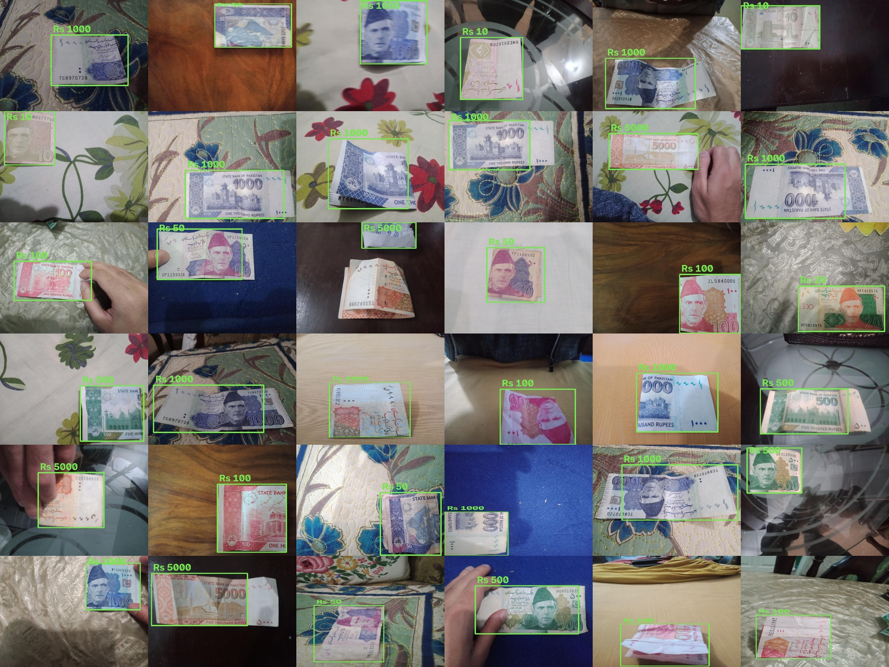
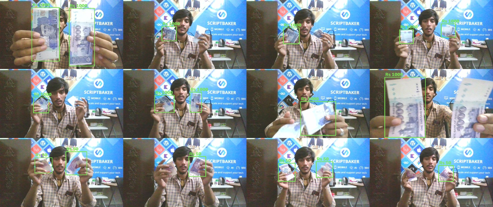

# Note Detection

**Real-time Pakistani banknote recognition that tells you, out loud, how much cash you're holding.**

Built for people who can't see their money. Point a webcam or phone camera at your notes and Note Detection
finds every note, adds them up, and speaks the result:

> *"Note detected. This is a 1000 rupee note."*
> *"A 50 rupee note has been added. You have 2050 rupees."*

It recognises all 7 notes (Rs 10, 20, 50, 100, 500, 1000, 5000), several at once, at about **30 FPS on a GTX 1050 Ti**.

```
Camera ──▶ YOLO26s (fine-tuned) ──▶ ByteTrack + 15-frame voting ──▶ what changed? ──▶ neural voice
                                                         │
                                  FastAPI: live dashboard · REST API · threshold slider
```

## Results

| Test set | mAP50 | Recall |
|---|---|---|
| All test photos (404 images) | **0.969** | 0.960 |
| My own webcam footage, round 1 → round 2 | 0.227 → **0.786** | 19% → **76%** |

Tracking with per-note voting cut wrong labels on my recordings from 5 to **0**.



## How it was built

**1. Data with zero manual labeling.** The [Pakistani Currency Notes](https://www.kaggle.com/datasets/muhammadammarabid/pakistanicurrencydataset)
dataset (3,611 photos, CC0) has no bounding boxes. **YOLOE-26**, a zero-shot detector prompted with "banknote",
draws the box, and the folder name gives the class.



**2. Fine-tuning.** Ultralytics **YOLO26s**, transfer-learned from COCO, with augmentation for a handheld camera
(rotation, lighting, mosaic, and shrinking photos to simulate distance). It is tuned for a 4 GB GPU: 512 px, batch 8, FP32.

**3. Closing the real-world gap.** Live testing missed notes held far away, so I recorded my own webcam footage
with `capture.py` and labeled it with **Grounding DINO**. Filters drop boxes that wrap several notes, never move
(desk objects) or have shapes no note has.



**4. Stable in real time.** **ByteTrack** follows each note across frames, and its value is a confidence-weighted
vote over its last 15 frames, so a blurred 1000 never reads as 50 for a moment.

**5. Voice and API.** A FastAPI server streams the annotated video to a light dashboard with a live total and a
detection-threshold slider. A Microsoft neural voice speaks only when something changes, and faster-whisper
can answer spoken questions ("How much money do I have?") in Urdu or English.

More detail, including every step and the challenges, is in [docs/PROJECT_OVERVIEW.md](docs/PROJECT_OVERVIEW.md).

## Tech stack

Python · PyTorch · Ultralytics YOLO26 · YOLOE-26 · Grounding DINO (Hugging Face Transformers) · ByteTrack ·
OpenCV · FastAPI · faster-whisper · edge-tts

## Project structure

```
├── app.py              # live app: camera → detection → tracking → voice, plus the FastAPI server
├── assistant.py        # what the app says (announcements and answers)
├── camera.py           # webcam, stream URL or scrcpy window input
├── voice.py            # text-to-speech and speech recognition
├── dashboard.html      # live web dashboard
├── capture.py          # record your own training frames from the webcam
├── prepare_data.py     # download, auto-label, clean and split the dataset
├── train.py            # fine-tune YOLO26 (supports --resume)
├── models/notes.pt     # the trained model
├── data/
│   ├── captured/       # my webcam frames, one folder per note value
│   └── labels.json     # cached auto-labels
└── docs/               # overview, training results and images
```

## Quick start

```bash
pip install -r requirements.txt
python app.py
```

Open http://localhost:8000. A CUDA build of PyTorch is recommended. Other cameras:

| Camera | Command |
|---|---|
| Laptop webcam | `python app.py` |
| Phone with DroidCam or OBS Virtual Camera | `python app.py --source 1` |
| Phone with the IP Webcam app | `python app.py --source http://PHONE_IP:8080/video` |
| Phone with scrcpy | `scrcpy --video-source=camera --camera-facing=back --window-title=NoteCam`, then `python app.py --source scrcpy` |

Options: `--conf 0.4` (detection threshold; also adjustable live on the dashboard), `--imgsz 640`,
`--voice en-US-AvaMultilingualNeural`, `--no-mic`, `--mute`.

## Train it yourself

```bash
python capture.py 50 1000     # optional: record your own frames, 90 s per note
python prepare_data.py        # downloads the Kaggle data and auto-labels everything
python train.py               # 10 epochs, about 1 hour on a GTX 1050 Ti
```

## API

```bash
curl -F "file=@note.jpg" http://localhost:8000/detect
curl -X POST http://localhost:8000/ask -H "Content-Type: application/json" -d "{\"text\": \"How much money do I have?\"}"
curl -X POST http://localhost:8000/settings -H "Content-Type: application/json" -d "{\"conf\": 0.5}"
```

Interactive docs are at http://localhost:8000/docs.

## Credits

- Dataset: *Pakistani Currency Notes Image dataset* by Muhammad Ammar Abid, Kaggle, CC0.
- Built by **Jahanzaib Tahir**, Associate AI Engineer.
